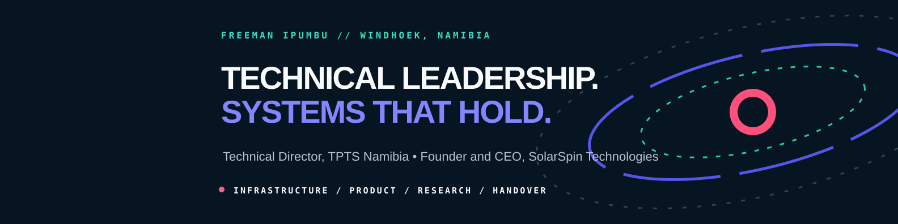
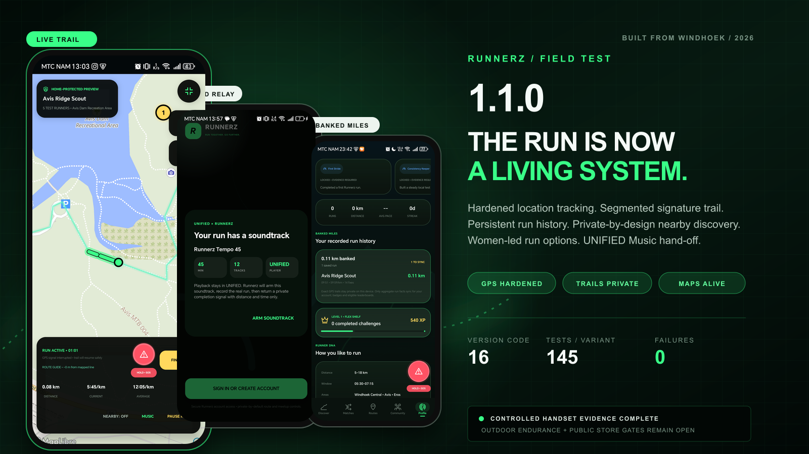

<p align="center">
  
</p>

<p align="center">
  <a href="https://freeman-ipumbu.pages.dev/"></a>
  <a href="https://www.solarspin-namibia.xyz/"></a>
  <a href="https://www.linkedin.com/in/freeman-paul-ipumbu/"></a>
  <a href="mailto:freeman.ipumbu@outlook.com"></a>
</p>

## I build systems that have to work after the applause.

I am **Freeman Paul Ipumbu**, a Namibian Technical Director, founder, systems builder and design science researcher based in Windhoek.

My career began close to the machinery: telecom network operations, offshore ICT, enterprise systems, security, service continuity and the records people reach for when something fails at 02:00. I now carry that operating discipline into financial technology, product architecture, full-stack delivery and digital experiences built to survive contact with the real world.

This profile is the public evidence trail of that work. The production source, credentials, personal data and protected operating material stay where they belong.

```text
OBSERVE  →  FRAME  →  DESIGN  →  BUILD  →  EVALUATE  →  HARDEN  →  SHIP
```

## Current orbit

- **Technical Director, TPTS Namibia.** Leading technical direction for practical, secure financial technology and the systems around it. TPTS owns its products; SolarSpin contributes selected digital-experience and engineering work where stated.
- **Founder and CEO, SolarSpin Technologies.** The company behind my independent products, selected client work and long-term technical legacy.
- **Founder and CEO, Runnerz Namibia.** Building a safer, privacy-conscious social running and walking ecosystem born in Windhoek.
- **Co-Founder and CTO, RightMatch Namibia.** Engineering the trust, evidence and operating controls behind responsible vehicle access.

I am also the author of **IT Handover Continuance**, a published design science project that treats institutional knowledge continuity as a living system instead of a document filed and forgotten.

My chapter at **The Free Press of Namibia / The Namibian / Namibia Media Trust** ended on 15 September 2026. It remains part of the foundation, not my present identity.

## Now transmitting

### SolarSpin digital headquarters

<p align="center">
  <a href="https://www.solarspin-namibia.xyz/"></a>
</p>

SolarSpin is where infrastructure discipline, product thinking, visual craft, operational evidence and proper handover meet. The headquarters is a living project observatory: switch between Solar Day and Interstellar, explore the **Public Atlas**, inspect relationships through the **Gravity Table**, and begin a secure conversation without leaving the experience.

I founded SolarSpin in November 2025 because the body of work had grown beyond what should keep moving under one person’s name. It is the company I intend to keep building for the rest of my life and part of the legacy I leave to my son, Kingsley.

**[Enter the experience ↗](https://www.solarspin-namibia.xyz/)** · **[Inspect the public build record ↗](https://github.com/freeman-ipumbu/solarspin-website-case-study)**

### TPTS Grid

<p align="center">
  <a href="https://tpts-grid.pages.dev/"></a>
</p>

A Namibia-first travel network built around one living map for destination anchors, custom route composition, road intelligence, factual stay discovery and human-verified host intake. TPTS owns the platform. Public stay records are discovery context, not confirmed live room inventory; booking, merchant-payment and external-channel activation remain gated behind their respective approvals.

**Role:** Technical direction through TPTS Namibia, with SolarSpin delivering the digital experience, product UX, MapLibre architecture, Namibia visual atlas and host-onboarding system.

**[Explore TPTS Grid ↗](https://tpts-grid.pages.dev/)** · **[Inspect the public case study ↗](https://github.com/freeman-ipumbu/tpts-grid-case-study)**

### Ontoko Foods

<p align="center">
  <a href="https://ontoko-foods.pages.dev/"></a>
</p>

An installable food-and-commerce experience for Jane Auala’s Groot Aub farm. Real farm storytelling, egg-order and enquiry requests, on-device return-client details, OpenStreetMap delivery pinning and a protected order desk live in one coherent system. Cash requests are live; availability, pricing and fulfilment remain subject to Ontoko’s confirmation. Hosted EFT and wallet payments stay activation-gated until merchant credentials are issued.

**[Visit Ontoko Foods ↗](https://ontoko-foods.pages.dev/)** · **[Inspect the public case study ↗](https://github.com/freeman-ipumbu/ontoko-foods-case-study)**

### Runnerz × UNIFIED

<p align="center">
  <a href="https://github.com/freeman-ipumbu/runnerz-android-case-study"></a>
</p>

Runnerz turns the run into a living system: route guidance, accepted-fix GPS hardening, movement metrics, history, banked miles, broad-area discovery and a deliberate music handoff. **UNIFIED Music** is its privacy-conscious, local-first companion with a protected library, queue intelligence, movement-aware spaces and a signed Runnerz relay. Exact trails stay local. Controlled candidates are never described here as public-production releases.

**[Enter Runnerz ↗](https://runnerznamibia.com/)** · **[Runnerz engineering record ↗](https://github.com/freeman-ipumbu/runnerz-android-case-study)** · **[UNIFIED engineering record ↗](https://github.com/freeman-ipumbu/unified-music-case-study)**

## Thirty-one systems. One evidence trail.

The full body of work is best experienced in the **[interactive portfolio](https://freeman-ipumbu.pages.dev/#builds)** or through SolarSpin’s **[Public Atlas](https://www.solarspin-namibia.xyz/#work)**. The catalogue below keeps every public claim, operating boundary and inspection route in one place without turning this profile into thirty-one repeated case studies.

<details open>
<summary><strong>Owned universe · 04 systems</strong></summary>

| System | Current signal | Inspect |
|---|---|---|
| **Runnerz Namibia** | Controlled release; public web live, Android candidate controlled | [Experience](https://runnerznamibia.com/) · [engineering record](https://github.com/freeman-ipumbu/runnerz-android-case-study) |
| **UNIFIED Music** | Namibia alpha; local-first music system and Runnerz relay | [Ecosystem](https://runnerznamibia.com/#official-music-player) · [engineering record](https://github.com/freeman-ipumbu/unified-music-case-study) |
| **RightMatch Namibia** | Controlled pilot; trust-first vehicle access | [Experience](https://rightmatchnamibia.com/) · [case study](https://github.com/freeman-ipumbu/rightmatch-namibia-case-study) |
| **Soek.Iets** | Access-code Windhoek pilot; regulated payment and integrated delivery not active | [Public use case](https://github.com/freeman-ipumbu/soek-iets-use-case) |

</details>

<details>
<summary><strong>Command and operations · 12 systems</strong></summary>

| System | Current signal | Inspect |
|---|---|---|
| **Fuel retail digital platform** | Anonymous public-safe concept; prospect and protected pilot undisclosed | [Case study](https://github.com/freeman-ipumbu/fuel-retail-digital-platform-case-study) |
| **Namibia FinePay** | Illustrative TPTS-led demo; takes no payments and connects to no institution | [Case study](https://namibia-finepay-case-study.pages.dev/) · [repository](https://github.com/freeman-ipumbu/namibia-finepay-case-study) |
| **ECC Command** | Protected multi-agency coordination pilot | [Pilot](https://ecc-command.pages.dev/) · [case study](https://github.com/freeman-ipumbu/ecc-command-case-study) |
| **Omutambo Herd Operations** | Namibia-first field command workspace | [Public surface](https://omutambo.pages.dev/) · [case study](https://github.com/freeman-ipumbu/omutambo-herd-case-study) |
| **Borizago** | Live shuttle booking and operations platform | [Experience](https://borizashuttles.pages.dev/) · [case study](https://github.com/freeman-ipumbu/borizago-case-study) |
| **Tito On Call** | Live full-stack mobile-barber platform | [Experience](https://titos-barber.pages.dev/) · [case study](https://github.com/freeman-ipumbu/tito-on-call-case-study) |
| **Utuseb Drinks & Delivery** | Live commerce and operations system | [Experience](https://utuseb.pages.dev/) · [case study](https://github.com/freeman-ipumbu/utuseb-case-study) |
| **MOHSS AIRMED COMMAND** | Synthetic national coordination concept; no patient data or statutory authority | [Demo](https://mohss-airmed.pages.dev/) · [case study](https://github.com/freeman-ipumbu/mohss-airmed-command-case-study) |
| **NamAir Command** | Controlled aviation command and crew-readiness demo | [Demo](https://namair-command.pages.dev/) · [case study](https://github.com/freeman-ipumbu/namair-command-case-study) |
| **NamMar Command** | Sanitised vessel-operations demo, not a navigation or statutory safety system | [Demo](https://nammar.pages.dev/) · [case study](https://github.com/freeman-ipumbu/nammar-command-case-study) |
| **KICKOFF NAM** | Live source-linked Namibian football archive | [Archive](https://kickoff-nam.pages.dev/) · [case study](https://github.com/freeman-ipumbu/kickoff-nam-case-study) |
| **TPTS Grid** | Live route intelligence and governed host intake | [Experience](https://tpts-grid.pages.dev/) · [case study](https://github.com/freeman-ipumbu/tpts-grid-case-study) |

</details>

<details>
<summary><strong>Digital experiences · 11 systems</strong></summary>

| System | Current signal | Inspect |
|---|---|---|
| **JB.Braids** | Live booking, Crown Club loyalty and private StudioDesk | [Experience](https://jb-braids.pages.dev/) · [case study](https://github.com/freeman-ipumbu/jb-braids-case-study) |
| **NAILED & Lashed by Mona** | Live booking, Mona Luxe Circle and private StudioDesk | [Experience](https://monaluxe.pages.dev/) · [case study](https://github.com/freeman-ipumbu/monaluxe-case-study) |
| **PDM Namibia** | Live national civic PWA; unrestricted intake and internal rails remain governed stages | [Platform](https://pdm-namibia.pages.dev/) · [case study](https://github.com/freeman-ipumbu/pdm-namibia-case-study) |
| **E.M.A. Namibia** | Live emergency-first public-interest experience | [Experience](https://ema-namibia.pages.dev/) · [case study](https://github.com/freeman-ipumbu/ema-namibia-case-study) |
| **OSH-Med International** | Live professional learning pathways | [Academy](https://osh-med-international.pages.dev/) · [case study](https://github.com/freeman-ipumbu/osh-med-international-case-study) |
| **Ontoko Foods** | Live ordering and operations platform | [Experience](https://ontoko-foods.pages.dev/) · [case study](https://github.com/freeman-ipumbu/ontoko-foods-case-study) |
| **Magic Boys Football Academy** | Live privacy-first youth football experience | [Academy](https://magicboys.pages.dev/) · [case study](https://github.com/freeman-ipumbu/magic-boys-fc-case-study) |
| **Omwenyo Renal Health Centre** | Live identity for a development-stage renal-care initiative | [Experience](https://omwenyo.pages.dev/) · [case study](https://github.com/freeman-ipumbu/omwenyo-digital-case-study) |
| **M & L Occupational Safety** | Live mobile-hardened safety consultancy experience | [Experience](https://ml-occupational-safety.pages.dev/) · [case study](https://github.com/freeman-ipumbu/ml-occupational-safety-case-study) |
| **Dream High Learning Institute** | Live learning and care experience | [Experience](https://dream-high-learning.pages.dev/) · [case study](https://github.com/freeman-ipumbu/dream-high-learning-case-study) |
| **Stephanie Madl Portfolio** | Live editorial travel-operations portfolio | [Portfolio](https://stephanie-madl.pages.dev/) |

</details>

<details>
<summary><strong>Research and build records · 04 systems</strong></summary>

| Record | Current signal | Inspect |
|---|---|---|
| **IT Handover Continuance** | Published, DOI-backed design science research | [Published record](https://doi.org/10.5281/zenodo.21840440) · [repository](https://github.com/freeman-ipumbu/it-handover-continuance-dsr) |
| **Career Arc Lab** | Live explainable career-route and 30-day proof-sprint pilot; no employment or income outcomes claimed | [Live pilot](https://career-arc-lab.onrender.com/) · [public case study](https://github.com/freeman-ipumbu/career-arc-lab-case-study) |
| **SolarSpin digital headquarters** | Live company experience with a public build record | [Headquarters](https://www.solarspin-namibia.xyz/) · [build record](https://github.com/freeman-ipumbu/solarspin-website-case-study) |
| **Freeman technical portfolio** | Live career and project evidence system | [Portfolio](https://freeman-ipumbu.pages.dev/) |

</details>

## Operating foundation

| Chapter | What it taught me |
|---|---|
| **MTC Namibia** | Telecom operations, incident pressure, network discipline and service continuity |
| **Offshore and marine ICT** | Remote support, constrained connectivity, safety context and precise handover |
| **The Namibian / Namibia Media Trust / The Free Press of Namibia** | Enterprise systems, security, newsroom continuity, public-interest technology and institutional stewardship |
| **Design science research** | How to turn a recurring organisational failure into an evaluated artefact rather than another memo |
| **TPTS Namibia** | Technical leadership at the meeting point of fintech, accountability, security and product readiness |
| **SolarSpin Technologies** | Giving a growing universe of systems one standard for craft, evidence, operating truth and handover |

## Engineering lens

### Infrastructure before interface

The interface is only the visible edge. I care about identity, access, backups, observability, network reality, deployment, failure modes and the operator who inherits the system.

### Evidence before theatre

Public demos are labelled as demos. Controlled releases are labelled as controlled. Integration gates remain visible. A persuasive experience should never require an untrue claim.

### Privacy by boundary

Private source, credentials, client records, payment proofs, exact locations and protected operational data do not become portfolio material. Public case studies explain decisions without exposing what does not belong in public.

### Handover is part of the build

Documentation, verification, owner training and continuity are not the leftovers after launch. They are part of the product.

## Open channel

| Conversation | Address |
|---|---|
| TPTS Namibia | [freeman@tptsnam.com](mailto:freeman@tptsnam.com) |
| SolarSpin / personal | [freeman.ipumbu@outlook.com](mailto:freeman.ipumbu@outlook.com) |
| Runnerz Namibia | [freeman@runnerznamibia.com](mailto:freeman@runnerznamibia.com) |
| RightMatch Namibia | [freeman@rightmatchnamibia.com](mailto:freeman@rightmatchnamibia.com) |

You can also find me on **[LinkedIn](https://www.linkedin.com/in/freeman-paul-ipumbu/)**, inspect the **[technical portfolio](https://freeman-ipumbu.pages.dev/)**, or enter the **[SolarSpin universe](https://www.solarspin-namibia.xyz/)**.

---

<p align="center"><strong>Built from Windhoek. Tested against reality.</strong></p>

<p align="center"><sub>Thirty-one systems across owned products, command and operations, digital experiences, research and public build records. Production boundaries remain explicit.</sub></p>
